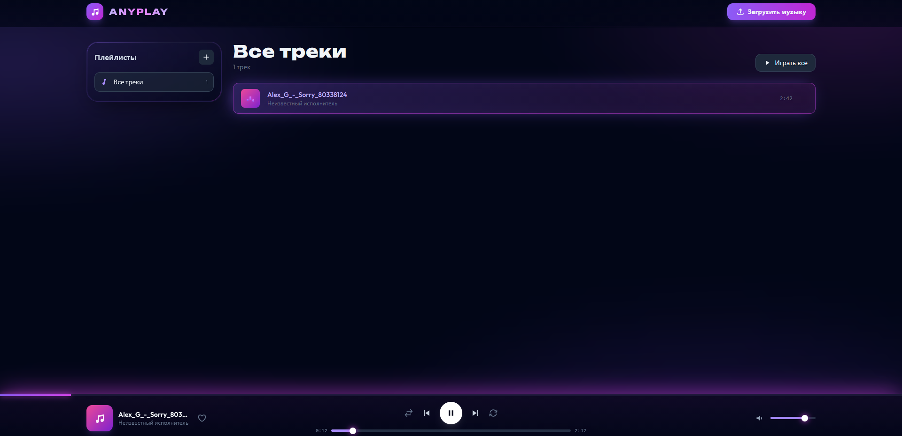

# 🎵 AnyPlay — Premium Client-Side Web Music Player

<p>
  
</p>

**AnyPlay** is a modern, lightweight, and visually stunning client-side web audio player. Built using **Vanilla JavaScript (ES6+)**, **HTML5 Media API**, and **Tailwind CSS**, it features a fully custom glassmorphism design with immersive "aurora" background animations. 

The application operates entirely within the user's browser, eliminating the need for a dedicated backend database while providing persistent data saving.
[https://okamicoder.github.io/AnyPlay]

---

## ✨ Core Features

- **Smart File Ingestion:** Supports multiple audio uploads (`.mp3`, `.wav`, `.ogg`, `.flac`, `.m4a`, `.aac`). 
- **Hybrid Storage Engine:** Automatically converts files under 12MB into `DataURL` format (Base64) to tightly pack playlist layouts directly inside browser `LocalStorage`. Larger tracks use efficient temporal memory Object URLs.
- **Dynamic Playlist Manager:** Seamlessly create custom playlists, delete them, append active queues to specific playlists, and easily toggle an automatic **"Favorites" (Избранное)** track stack.
- **Custom Player Architecture:** Fully re-built audio controls featuring:
  - Responsive **Play/Pause**, **Next/Prev** skip-stepping.
  - Granular **Volume & Mute** toggle state memory.
  - Interactive **Seek bar (Scrubber)** utilizing linear progress input.
- **Advanced Playback Modes:** Integrated **Shuffle** toggling and a 3-tier **Repeat Engine** (Off / Repeat Single Track / Repeat Queue Loop).
- **Global Keyboard Hotkeys:** 
  - `Space` — Toggle Play/Pause.
  - `ArrowLeft` / `ArrowRight` — Skip backward/forward by 5 seconds.
  - `ArrowUp` / `ArrowDown` — Granular volume control adjustment.
- **Polished Cinematic UI:** Features custom CSS neon glows, synchronized CSS audio spectrum bands (`.eq playing`), smart hover effects (`.track-row`), dynamic color theme assignment based on track metadata, and hardware-accelerated fluid notifications (`toast`).

---

## 🛠️ Tech Stack & Dependencies

- **Structure:** HTML5 Semantic Markup
- **Styling:** Tailwind CSS (v4 CDN) with custom CSS components for scrollbars, inputs, and animations.
- **Fonts & Typography:** Google Fonts (*Unbounded*, *Outfit*)
- **Core Engine:** Pure Vanilla JavaScript (Native Web Audio Events, Promises, asynchronous FileReaders, LocalStorage API).

---

## 🚀 How It Works (Deep Dive)

1. **Smart Splitting:** When you drag or upload audio tracks via the `HTML5 File API`, the script checks the physical file size. If a file is under **12MB**, it reads it using an asynchronous `FileReader()` into a persistent string. If it's larger, it uses a temporal memory snapshot via `URL.createObjectURL(file)`.
2. **Metadata Separation:** The engine automatically analyzes filenames. If it detects a hyphen (`Artist - TrackTitle`), it auto-assigns values; otherwise, it cleanly strips the extension and populates fallback strings.
3. **Fluid Layout Synchronization:** State loops monitor native audio nodes via event loops like `timeupdate`, `loadedmetadata`, and `ended`. This locks custom sliders, fills, timers, and the dynamic SVG visualization board precisely to the millimeter without relying on heavy external animation frameworks.

---

## 📦 Getting Started

Because **AnyPlay** relies completely on sandbox client technologies, **no server-side, Node.js packages, or local environment configurations are necessary**.

1. **Clone this workspace:**
   ```bash
   git clone https://github.com/OkamiCoder/AnyPlay/
   ```
2. **Move inside the directory:**
   ```bash
   cd AnyPlay
   ```
3. **Launch the player:**
   Open `index.html` directly in any web browser, or serve it securely with the **Live Server** extension in Visual Studio Code.

---

## 🗺️ Roadmap & Continuous Improvements

- [ ] Parse native binary metadata (ID3 tags) to extract true track album artwork cover art images.
- [ ] Incorporate physical Drag-and-Drop upload surfaces.
- [ ] Connect a visual node graphic equalizer using `AudioContext.createAnalyser()`.

---

## 📄 License

This repository is distributed under the MIT License. Feel free to remix, modify, and optimize it.
